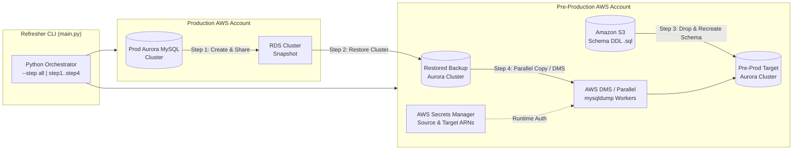

# AWS Aurora MySQL Database Environment Refresher


A modular Python CLI automation tool that refreshes pre-production **AWS Aurora MySQL** environments from production backups across AWS accounts. It orchestrates snapshot creation, cross-account snapshot sharing, temporary cluster restoration, S3-driven DDL schema resets, and parallelized table data migration (via `mysqldump`, chunked connector streaming, or **AWS Database Migration Service (DMS)**).

---

## 🎯 Use Case & Problem Statement

In enterprise cloud environments, keeping staging/pre-production databases synchronized with production data is often slow, error-prone, and risky when performed manually across separate AWS accounts.

**This tool solves that workflow end-to-end by:**
1. **Isolating Production Load:** Never reads heavy table exports directly from the live production instance—instead, it snapshots production, shares the snapshot cross-account, and restores an isolated staging source cluster.
2. **Automating Schema Drift Reset:** Fetches canonical schema DDL from Amazon S3 to cleanly recreate the target schema before loading data.
3. **Hybrid High-Throughput Data Copy:** Automatically routes smaller tables through parallel Python worker threads, large tables (above a configurable row threshold) through streamed `mysqldump`, or full workloads through **AWS DMS** replication tasks.
4. **Resilient Recovery:** Tracks table-level failures and automatically retries only failed tables up to `max_failed_table_retries`, while pulling all credentials dynamically from **AWS Secrets Manager**.

---

## 🏗️ System Architecture



### Pipeline Stages
| Step | Flag | Responsibility |
| :--- | :--- | :--- |
| **Step 1** | `--step step1` | Creates a timestamped cluster snapshot of production Aurora MySQL and grants cross-account restore permissions to `target_account_id`. |
| **Step 2** | `--step step2` | Discovers the latest shared snapshot in the target account and restores a temporary backup cluster inside the target VPC subnet/security groups. |
| **Step 3** | `--step step3` | Connects to the pre-production target database via Secrets Manager, drops the target schema, downloads the canonical DDL script from S3, and recreates the schema. |
| **Step 4** | `--step step4` | Migrates table data from the restored backup cluster to the pre-production target cluster using parallel threads, threshold-based `mysqldump`, or AWS DMS, with automatic per-table retry logic. |

---

## 📁 Project Structure

```text
Database-environment-refresher/
├── main.py                 # CLI entrypoint and 4-stage pipeline orchestrator
├── config.yaml             # Declarative configuration (accounts, clusters, S3, DMS, parallelism)
├── requirements.txt        # Python dependencies (boto3, PyYAML, mysql-connector-python)
└── modules/
    ├── aws_utils.py        # Boto3 RDS snapshot creation, cross-account sharing, and cluster restore
    ├── db_utils.py         # Secrets Manager auth, parallel table copy, mysqldump streaming, AWS DMS tasks
    ├── ddl_utils.py        # S3 DDL retrieval and SQL statement parser
    └── logger.py           # Structured console + file logging with step-level context tags
```

---

## 🚀 Prerequisites & Setup

### Prerequisites
- **Python:** `3.8+`
- **AWS Credentials:** Configured via `aws configure` or IAM roles with permissions for `rds:*`, `dms:*`, `secretsmanager:GetSecretValue`, and `s3:GetObject`.
- **MySQL CLI Tools (Optional):** `mysqldump` and `mysql` on `PATH` when using threshold-based fast table dumps (`row_threshold_for_mysqldump`).

### Installation

```bash
# 1. Clone the repository
git clone https://github.com/gmanojkumar2000/Database-environment-refresher.git
cd Database-environment-refresher

# 2. Create a virtual environment & install dependencies
python -m venv .venv
source .venv/bin/activate  # Windows PowerShell: .\.venv\Scripts\Activate.ps1
pip install -r requirements.txt
```

### Configuration (`config.yaml`)
Update `config.yaml` with your AWS account IDs, cluster identifiers, S3 DDL path, and Secrets Manager ARNs (never store plaintext passwords in `config.yaml`):

```yaml
source_account_id: '123456789012'
target_account_id: '210987654321'
region: 'us-east-1'

source_db_cluster_identifier: 'prod-aurora-cluster'
target_db_cluster_identifier: 'preprod-aurora-cluster'
backup_db_instance_identifier: 'prod-backup-db'

backup_db:
  host: 'prod-backup-db.cluster-xxxxxx.us-east-1.rds.amazonaws.com'
  port: 3306
  dbname: 'analytics'

target_db:
  host: 'preprod-app-db.cluster-yyyyyy.us-east-1.rds.amazonaws.com'
  port: 3306
  dbname: 'analytics'

schema_to_refresh: 'analytics_schema'
tables_to_copy:
  - table1
  - table2
  # Or set to: all

row_threshold_for_mysqldump: 100000
parallel_table_copies: 4
max_failed_table_retries: 2
log_level: INFO

dms:
  enabled: false
  replication_instance_arn: ''
  source_endpoint_arn: ''
  target_endpoint_arn: ''
  migration_task_settings: ''

s3_ddl_bucket: 'my-ddl-bucket'
s3_ddl_prefix: 'ddls/analytics_schema.sql'
subnet_group: 'my-db-subnet-group'
vpc_security_group_ids:
  - 'sg-0123456789abcdef0'

source_db_secret_arn: 'arn:aws:secretsmanager:us-east-1:123456789012:secret:prod-db-secret'
target_db_secret_arn: 'arn:aws:secretsmanager:us-east-1:210987654321:secret:preprod-db-secret'
```

---

## 💻 How to Run

### Run the Full End-to-End Refresh Pipeline
```bash
python main.py --step all --log-file refresh.log --log-level INFO
```

### Run Individual Pipeline Steps
```bash
# Step 1: Create production snapshot & share with target account
python main.py --step step1 --snapshot-name prod-aurora-manual-snap

# Step 2: Restore temporary cluster from latest shared snapshot
python main.py --step step2 --subnet-group my-db-subnet-group --vpc-sg sg-0123456789abcdef0

# Step 3: Drop & recreate schema on target DB using S3 DDL
python main.py --step step3

# Step 4: Copy specific tables (or all configured tables) with automatic retry
python main.py --step step4 --tables users orders transactions
```
